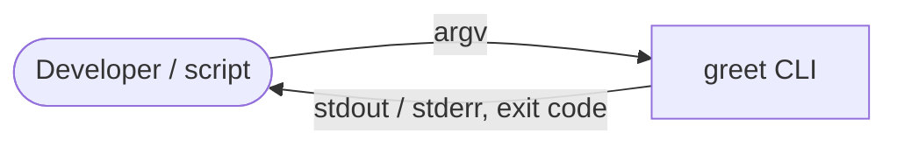

# greeter-cli: Architecture

## 1. Context

## 2. Building blocks
| Component | Responsibility | Technology |
|-----------|----------------|------------|
| `greeter.core` | Pure function `greeting(name, lang)` | Python |
| `greeter.cli` | Argument parsing, exit codes | Python `argparse` ([ADR-0001](adr/0001-use-argparse.md)) |

## 3. Data
None. The tool is stateless.

## 4. Runtime view
Parse arguments, call `greeting()`, print the result. A `ValueError` leads to exit code 2 with a message on stderr.

## 5. Deployment
Distributed as source. Run with `python -m greeter`.

## 6. Cross-cutting concerns
- **Security:** no input other than argv, no I/O beyond stdout and stderr.
- **Logging & observability:** not needed. Errors go to stderr.
- **Error handling:** invalid input gives exit code 2, consistent with argparse.

## 7. Quality attributes
| NFR | How it is met |
|-----|---------------|
| NFR-001 | Standard library only; verified by a test that inspects imports |

## 8. Decisions
See `docs/adr/`.
